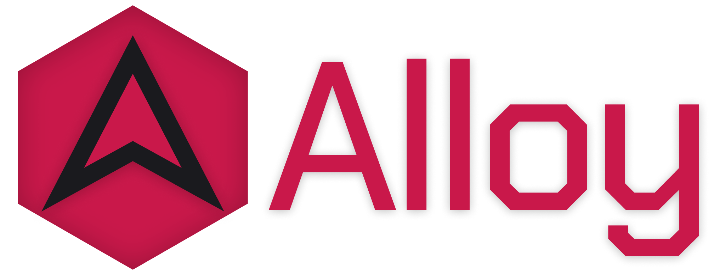



  

# Alloy Modules
These modules are designed to be treated like NuGet packages while still allowing developers to modify internals if they wish.

## Alloy.Audio
A custom audio engine built on OpenTK's OpenAL wrapper. 
It pulls OpenAL Soft binaries from Silk.NET's redistribution NuGet package and loads them manually.

## Alloy.Common
Shared code used across all Alloy modules and client.

## Alloy.ContentBuilder
A content builder similar to MonoGame's MGCB, but configured with XML instead.

## Alloy.ContentReader
The runtime content types produced by Alloy.ContentBuilder, which AlloyClient loads.

## Alloy.Engine
A lightweight game window and core OpenGL wrapper objects (such as textures, shaders, buffers).

## Alloy.UiLib
A UI library modeled after Adobe Flash's ActionScript 3 display list and event system. 
It is built around minimizing draw calls by batching vertex data instead of using individual textures. 
It includes extras like a built-in GTween and UiAnchors, while omitting many Flash features such as filters and vector graphics.
